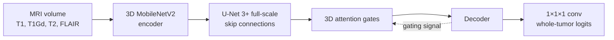

# Attention 3D U-Net with Multiple Skip Connections

> Nodirov J., Abdusalomov A.B., Whangbo T.K. **Attention 3D U-Net with Multiple Skip Connections for Segmentation of Brain Tumor Images.** *Sensors* 22(17): 6501, 2022. [doi:10.3390/s22176501](https://doi.org/10.3390/s22176501)

3D U-Net with a **MobileNetV2** encoder, **U-Net 3+** full-scale skip connections, and **attention gates**. Trained on **BraTS-2020** (T1, T1Gd, T2, FLAIR → whole-tumor mask): Adam, lr 0.01, ReduceLROnPlateau, batch size 2, BCE, 200 epochs.

## Architecture



- **Encoder** — 3D MobileNetV2 blocks (§3.2): 1×1×1 expand, 3×3×3 depthwise, 1×1×1 project, ReLU6.
- **Skips** — U-Net 3+ (§3.3): each decoder scale sees every encoder scale plus deeper decoder maps.
- **Attention gates** — 3D AG (§3.4): gating from the coarser map filters the fused skip.
- **Head** — 1×1×1 conv, logits for binary whole-tumor (BCE, §4.3).
- **Norm** — GroupNorm (stable at the paper’s batch size of 2).

Paper input size is 240×240×155.

## Setup

```bash
python3 -m venv .venv
source .venv/bin/activate
pip install -r requirements.txt
```

## Train

BraTS 2020 case folders under `data/brats2020/`, each with `*flair.nii.gz`, `*t1.nii.gz`, `*t1ce.nii.gz`, `*t2.nii.gz`, `*seg.nii.gz`. Whole-tumor label is any non-zero BraTS class.

```bash
PYTHONPATH=src python scripts/train.py --config configs/default.yaml
```

`configs/default.yaml` follows §4.3. Default crop is 128³; set `size: [240, 240, 155]` to match the paper if memory allows.

A small synthetic run (no BraTS download):

```bash
PYTHONPATH=src pytest tests -q
PYTHONPATH=src python scripts/train.py --config configs/small.yaml
```

## Experiments

The paper method is one config. The rest are trials (ablations, other losses, SE skips, transformer bottleneck, deep supervision, augmentation). They may beat the paper or lose. See [EXPERIMENTS.md](EXPERIMENTS.md).

```bash
PYTHONPATH=src python scripts/train.py --config configs/experiments/bce_dice.yaml
```

## Results

These numbers are from the paper, for whole-tumor segmentation. The code here has not reproduced them yet, see [EXPERIMENTS.md](EXPERIMENTS.md).

| Method (paper Table 1) | Dice | Hausdorff | Recall | Precision |
|---|---|---|---|---|
| **This model, pretrained** | **0.8974** | **5.76** | 0.8863 | 0.9087 |
| This model, no pretrained weights | 0.8854 | 5.90 | 0.8784 | 0.8925 |
| 3D U-Net++ | 0.8784 | 5.98 | 0.8712 | 0.8857 |
| SwinBTS | 0.8764 | 6.12 | 0.8733 | 0.8795 |
| VT U-Net | 0.8745 | 6.97 | 0.8699 | 0.8790 |
| Attention 3D U-Net | 0.8598 | 6.24 | 0.8582 | 0.8613 |
| 3D U-Net | 0.8215 | 6.97 | 0.8132 | 0.8299 |

| Removed from the model (paper Table 3) | Dice | Hausdorff |
|---|---|---|
| Nothing, final result | 0.8974 | 5.76 |
| Skip connections | 0.8615 | 6.04 |
| Attention | 0.8595 | 6.21 |
| MobileNet encoder | Out of memory | |

Table 2 of the paper lists 52.3 million parameters and a prediction time of 55.7 s.

## Layout

```
src/attn3dunet/           model, data, train, metrics
configs/experiments/      paper + extra trials
*.py, output/             2022 architecture scripts and checkpoints
brats_loading/            2021 BraTS loading scripts
data/                     sample NIfTI volumes
tests/
scripts/
```

## License

Code: MIT. Paper: [CC BY 4.0](https://creativecommons.org/licenses/by/4.0/).
